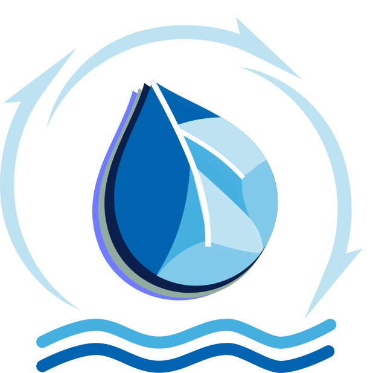

<!-- # HYDROTEL -->

 

  

<h1 align="center">HYDROTEL</h1>
  

    Physically-based distributed hydrological model.
    <!--  
    <a href="https://hydrotel.readthedocs.io/en/latest/"><strong>Explore the docs »</strong></a>
      -->
  

### Built With 

<!-- ABOUT THE PROJECT -->
### About HYDROTEL

<!-- [![Product Name Screen Shot][product-screenshot]](https://example.com) -->

HYDROTEL[1] is a physically-based semi-distributed hydrological model developed at the Centre Eau Terre Environnement of the Institute national de la recherche scientifique in Quebec (Canada). The model was programmed in C++ language using a modular approach allowing easy user-selection of different algorithms across different hydrological processes, such as:

* Meteorological data interpolation
* Snowpack and glacial evolution
* Soil temperature and frozen depth
* Potential evapotranspiration
* Vertical water budget
* Overland flow routing (geomorphological unit hydrograph)
* Channel routing
* Wetland hydrology

This repository contains the files required to run HYDROTEL from the command line. This approach requires compiling the C++ source files for the target operating system to generate the appropriate executable (e.g., hydrotel.exe on Windows).

<!-- REFERENCES -->
### References

1. J.-P. Fortin, R. Turcotte, S. Massicotte, R. Moussa, J. Fitzback, and J.-P. Villeneuve, "Distributed watershed model compatible with remote sensing and GIS data. Part I: Description of model", Journal of hydrologic engineering, vol. 6, no. 2, pp. 91-99, 2001, doi: 10.1061/(ASCE)1084-0699(2001)6:2(91)

<!-- ACKNOWLEDGMENTS -->
### Acknowledgments

The logo was designed by Andrés Gonzalez (@gonzmoaf) and Professor Alain N. Rousseau, with inputs from his Research group in hydrological modeling and integrated watershed management at the Centre Eau Terre Environnement - Institut national de la recherche scientifique (INRS)

<!-- MARKDOWN LINKS & IMAGES -->